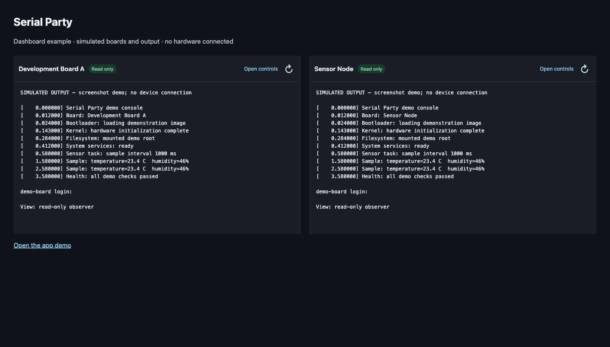
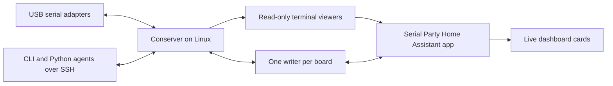
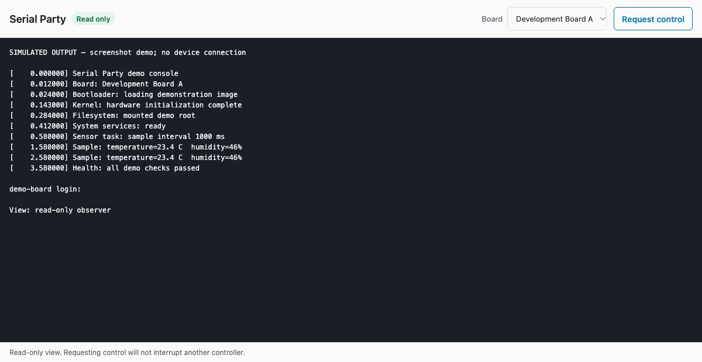

# Serial Party

**Many viewers. One keyboard.**

Serial Party puts live serial consoles in Home Assistant while automation tools
use the same connection. Watch boot logs on a dashboard, open a full console
when you need it, and let an agent work without competing for the USB adapter.

This is an early **0.1.0** release extracted from a working lab setup. It supports
multiple configured boards on one Linux serial host. Installation and migrations
are deliberate operations: importing the package or opening a dashboard does not
reconfigure your hardware.



*The screenshots use simulated boards and sample output. No personal devices,
network addresses, credentials, or camera images are shown.*

## What it does

- One Conserver process owns each physical UART; viewers receive the same output.
- Each board has its own name, adapter, baud rate, monitor port, and control port.
- Dashboard cards connect automatically as **read-only** viewers.
- The full app starts read-only and offers an explicit **Request control** action.
- A busy writer is refused immediately. Clients never force a takeover or wait
  in a queue to acquire control unexpectedly.
- Shell and Python clients let tools such as Hermes, Codex, and CI jobs use the
  same ownership rules.
- Home Assistant ingress handles browser authentication. The upstream terminal
  credential stays on the server.

## How it fits together



The **host package** runs beside the serial adapters, typically on a Raspberry Pi
or a small Linux machine. The **Home Assistant app** proxies those terminals over
your local network. The **dashboard card** embeds a read-only terminal using the
current user's authenticated Home Assistant session.

## Get started

1. [Install and configure the Linux host](docs/host.md).
2. [Install the Home Assistant app and dashboard card](docs/home-assistant.md).
3. [Connect your automation tools](docs/agents.md).

Host requirements: Python 3.11+, systemd, Conserver, and a ttyd version supporting
read-only sessions and the `-W`, `-b`, and `-m` options. The Home Assistant app
requires Supervisor app support, normally provided by Home Assistant OS; the
dashboard card requires **Home Assistant 2026.11 or newer** for its ingress
WebSocket APIs.



## Example agent session

Run on the Linux host, normally over SSH:

```sh
serial-party-console --board board-a monitor
serial-party-console --board board-a control --label operator
serial-party-console --board board-a status
```

Python uses a small, text-oriented subset of pySerial's interface:

```python
from serial_party import Serial, SerialBusyError

try:
    with Serial("board-a", timeout=0.2, write_timeout=2, label="hermes") as console:
        # Send only commands appropriate for the board's current state.
        console.write(b"help\r")
        console.flush()
        output = console.read(4096)
except SerialBusyError:
    # Someone else owns the writer. End this attempt and retry deliberately later.
    pass
```

The example sends a command and is not a health check. Read-only monitoring does
not need to send anything to the board.

## Boundaries

- This is a text console, not a flashing or binary-transfer protocol. Byte
  `0x1d` (Ctrl-]) is reserved for console control and rejected in Python writes.
- `flush()` confirms that the broker parsed preceding input; it does not confirm
  that a command finished on the board.
- Logs contain target output and session events. Transmitted input appears only
  when the target echoes it; this is not an independent TX/RX wire capture.
- Every writer must use the broker. A privileged process can bypass ordinary
  device permissions, so agents must not fall back to raw serial or `sudo`.
- The host HTTP terminals use Basic authentication. Keep them on a trusted LAN
  or behind a protected tunnel/TLS proxy; Basic authentication is not encryption.
- A disconnected dashboard feed can be reopened with **Reconnect**. Merely
  viewing a card never requests write ownership.

See [security and access](docs/security.md), [migration and rollback](docs/migration.md),
and [development and tests](CONTRIBUTING.md) for operational details.

## License

GPLv3, as provided by this repository's [LICENSE](LICENSE). Conserver, ttyd,
Home Assistant, Python, and the app's libraries are separate projects with their
own licenses. No Conserver or ttyd binary is bundled here.
